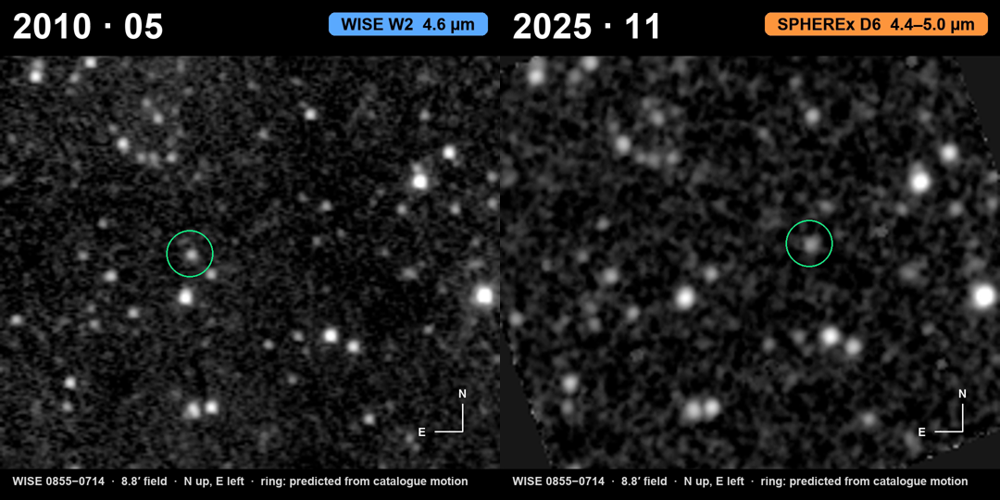

# SkyLapse
**Watch 16 years of the infrared sky — and catch what moves.**
NASA Space Apps Challenge 2026 · Baku · Team FARAD · Challenge: *Planet X and SPHEREx*

**Live prototype: https://skylapse.vercel.app** — open a NASA test target, or type any RA/Dec or star name.

## What it is
NASA's SPHEREx maps the whole sky in 102 infrared colours, but its own record is only about a year long, so nearby stars and brown dwarfs
move by just a pixel or two. NASA's WISE/NEOWISE watched the same sky at the same wavelength (4.6 µm) from 2010 to 2024.
SkyLapse joins both into **one 16-year blink movie of any patch of sky**, measures how fast things move, shows SPHEREx's spectral
fingerprint of each object, and explains it in plain English and Azerbaijani — for students, teachers and citizen scientists.

## How it works
1. **Find the field** — a name or RA/Dec is resolved; the field is centred for the object's motion.
2. **Collect 16 years of images** — 23–48 unWISE time-resolved WISE/NEOWISE epochs (2010–2024) and every SPHEREx visit (2025–2026, IRSA DR1 + QR3).
3. **Clean** — SPHEREx: zodiacal light subtracted, bad/saturated pixels flagged from each image's own flag names; WISE: saturation masked.
4. **One grid** — everything is reprojected (Astropy) onto one sky grid; SPHEREx visits are co-added per detector and time cluster.
5. **Measure and explain** — positions per epoch → proper-motion fit, compared with ESA Gaia DR3 and the literature; spectra and light curves;
   a blind search for movers; a short AI explanation written only from the measured numbers.

Precomputed NASA targets load from a static bundle (the demo never depends on a live archive). Any other position is built live from
WISE in seconds (`api/`, WISE-only on the free tier; SPHEREx frames are precomputed for the NASA targets).

## Does it work? (validation)
| NASA test target | what we measured | reference | agreement |
|---|---|---|---|
| Barnard's Star | proper motion 10 395 ± 17 mas/yr (36 WISE epochs, 14 yr) | Gaia DR3: 10 393 | **99.8 %** |
| ε Indi B | 4 717 ± 10 mas/yr (46 epochs) | Gaia DR3: 4 684 | **99.0 %** (moves with ε Indi A: 99.3 %) |
| WISE 0855−0714 | 8 157 ± 15 mas/yr (23 epochs) | Kirkpatrick et al. 2021: 8 152 | **99.9 %** |
| R Draconis | pulsation period 246 d (W1) / 247 d (W2) from a relative brightness index (star saturates WISE and SPHEREx) | AAVSO VSX: 246.12 d | match |
| RW Aurigae | variability 0.24 / 0.40 mag rms vs 0.03 / 0.05 for a constant comparison star | NEOWISE photometry (r = 0.93 / 0.98) | consistent |

Blind search over the 5 fields: **3 of 3 known fast movers recovered, 0 false alarms.** SPHEREx spectrum of WISE 0855: dark below 3 µm,
detected at 4.4–4.9 µm, as expected for a ~250 K brown dwarf.
Details and caveats: [`science/VALIDATION.md`](science/VALIDATION.md) · [`science/QA_FACTS.md`](science/QA_FACTS.md) ·
[`science/LIGHTCURVES.md`](science/LIGHTCURVES.md) · [`science/SPECTRA.md`](science/SPECTRA.md) · [`science/DISCOVERY.md`](science/DISCOVERY.md)

**Methodology** (existing approaches, their gap, our approach, references): [`docs/METHODOLOGY.md`](docs/METHODOLOGY.md)

We never claim discoveries: anything new is a *candidate for follow-up*.

## Repository
| folder | what |
|---|---|
| `pipeline/` | Python: data access (IRSA SPHEREx, unWISE epochs, Gaia, CatWISE), calibration, reprojection, co-adds, bundle export, live runner |
| `science/` | proper-motion fits, spectra, light curves, blind mover search, AI copilot texts |
| `web/` | Vite + React + TypeScript viewer (canvas blink player, overlays, charts); `web/public/bundle/` = precomputed data |
| `api/` | FastAPI: name resolution, live WISE fields, optional live copilot |
| `docs/` | plan, architecture, data contract, science notes, methodology |
| `pitch/` | story, facts with sources, Q&A, backup videos (`pitch/video/`) |

Run locally: `cd web && npm ci && npm run dev` (static bundle included) · API: `pip install -r api/requirements.txt && uvicorn skylapse_api.main:app --app-dir api`.
Rebuild a field: `python -m skylapse_pipeline build --field wise0855` (in `pipeline/`).

## Data and credits
- **NASA SPHEREx** — images from the NASA/IPAC Infrared Science Archive (IRSA), DR1 + QR3.
- **NASA WISE / NEOWISE** — unWISE time-resolved coadds (Meisner et al.), served by byw.tools (Backyard Worlds: Planet 9 / AMNH).
- **ESA Gaia DR3** — positions and proper motions (Gaia Collaboration). Space-agency partner data.
- **CatWISE2020** (Marocco et al. 2021) — faint infrared movers (not used as a motion reference for ε Indi B, where it is known to be wrong).
- CDS Sesame / SIMBAD for names; Astropy, NumPy, SciPy, photutils, FastAPI, React, Vite. Full list: [`pitch/REFERENCES.md`](pitch/REFERENCES.md).

## Use of AI (local organizers' rule: disclosed)
We used AI openly. AI coding assistants (Claude Code, Anthropic) helped our team write the pipeline and the web app; humans set the concept,
checked the science and reviewed every merge. The plain-language explanations (English and Azerbaijani) are written by an AI model
(`claude-opus-5-5`) **only from numbers our pipeline computed**, are checked by a number guard, and are labelled "AI-generated" on the site.
No AI-generated images, logos or mission symbols. The agents' instructions are in this repository on purpose (`CLAUDE.md`, `ops/`, `prompts/`).
Details: [`pitch/AI_USE.md`](pitch/AI_USE.md).

## Team FARAD
Amal Mirzayev · Hasan Dadashzada · Murad Qaramollayev · Azer Valiyev · Kanan Pashazada

Licence: Apache-2.0 (see `LICENSE`).
